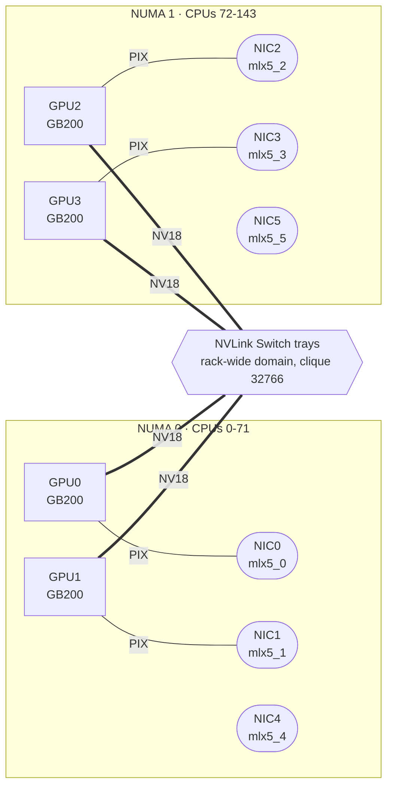

# blackwell-cluster-playbook

Bring-up, validation and benchmarking for NVIDIA Blackwell GPU clusters, from a single
HGX B200 node to a GB200/GB300 NVL72 rack.

[](https://github.com/sahilkalgutkar/blackwell-cluster-playbook/actions/workflows/ci.yml)
[](https://github.com/sahilkalgutkar/blackwell-cluster-playbook/actions/workflows/stack-watch.yml)

New GPU nodes fail in boring, expensive ways: one NVLink down, a NIC on the wrong socket,
an NVL72 tray that never joined the rack's NVLink domain. This repo is a checklist for
deciding whether to trust a node with a real job, plus the configs to put those nodes behind
Slurm or Kubernetes and serve models on them.

- **`bcp`**, a small Python CLI that detects the platform (HGX baseboard, DGX, NVL72 tray),
  runs DCGM, nccl-tests and nvbandwidth, and turns the output into pass/fail checks and a
  results JSON.
- **HPC**: Ansible for Slurm + Pyxis/Enroot, with Slurm block topology for NVL72 racks, plus
  multi-node nccl-tests and HPL jobs.
- **Kubernetes**: GPU Operator, the DRA driver's ComputeDomains for multi-node NVLink, KAI
  Scheduler queues, and DCGM alerts.
- **Inference**: NVIDIA Dynamo serving with separate prefill and decode workers, benchmarked
  with AIPerf.
- **A pinned stack** in [`matrix/stack.yaml`](matrix/stack.yaml) that a weekly workflow
  checks against upstream releases, opening a PR when something moves.

## Status

Be clear-eyed about what has run where:

| Part | State |
|---|---|
| `bcp` CLI, parsers, checks | Working. 71 tests, end-to-end demo in CI on synthetic fixtures |
| Rental day (`bcp rental`) | Scripted and tested without GPUs: plans, generated scripts, resume logic, reports and redaction in CI; the training loop runs on CPU in CI. Not yet run on a GPU node |
| Real-hardware results | **None yet.** See [docs/rental-runbook.md](docs/rental-runbook.md) |
| `hpc/`, `k8s/`, `inference/` | Drafts. Syntax- and schema-checked in CI, not yet run on hardware |

Everything under [`fixtures/`](fixtures/) is synthetic: modelled numbers in the exact format
the real tools print. Every report built from it says so.

## Quick start (no GPU needed)

```bash
git clone https://github.com/sahilkalgutkar/blackwell-cluster-playbook && cd blackwell-cluster-playbook
make demo
```

`make demo` runs the full pipeline against four fixture nodes and expects the broken one to
fail:

```text
$ bcp validate --replay fixtures/dgx-b200-degraded
Verdict: FAIL  (synthetic-dgx-b200-degraded, replay:fixtures/dgx-b200-degraded) · SYNTHETIC fixture
Platform: HGX 8-GPU baseboard (NVSwitch) · 8 x NVIDIA B200

STATUS  CHECK                                          MEASURED                   EXPECTED
pass    inventory.gpu_count                            8                          == 8
fail    topology.nvlink_symmetry                       GPU5 NV16                  all NV18
          ↳ a GPU with fewer active NVLinks than its peers
fail    dcgm.diag                                      fail                       pass
          ↳ pcie (GPU 5): GPU 5: NVLink 7 and 13 are down (link state inactive)
fail    nccl.all_reduce.busbw                          565.3 GB/s @ 8.0 GiB       >= 650 GB/s
pass    nccl.all_gather.busbw                          615.6 GB/s @ 8.0 GiB       >= 550 GB/s
pass    nccl.reduce_scatter.busbw                      610.5 GB/s @ 8.0 GiB       >= 550 GB/s
fail    nccl.alltoall.busbw                            469.5 GB/s @ 8.0 GiB       >= 500 GB/s
pass    nvbandwidth.device_to_device_memcpy_read_ce    750.0 GB/s avg             >= 650 GB/s
...
```

The fixture models a common failure: two NVLinks down on one GPU. A real degraded link tends
to show up in several places at once (the topology matrix, DCGM, collective bandwidth) while
point-to-point copy tests can look nearly normal, which is why the checks cover all of them.
The numbers here are modelled, so treat the size of the drop as illustrative.

## On a real node

```bash
pip install -e .
bcp topology                                  # what is this machine?
bcp collect --suite full --out runs/raw/node01 # ~45 min on 8 GPUs; saves raw output only
bcp validate --replay runs/raw/node01          # analyse now, or later on your laptop
bcp report build/runs/*.json --out results/summary.md
```

`collect` keeps raw output, so a few hours of rented time can be analysed (and re-analysed
when the thresholds improve) long after the instance is gone. It needs `nvidia-smi`, `dcgmi`,
[nccl-tests](https://github.com/NVIDIA/nccl-tests) (point `BCP_NCCL_TESTS_DIR` at its
`build/`) and [nvbandwidth](https://github.com/NVIDIA/nvbandwidth) on the node. Anything
missing is reported as skipped rather than failing the run.

### What `bcp topology` sees on an NVL72 tray



Only 4 GPUs are local to the tray, but `nvidia-smi -q` reports that each one has joined a
rack-wide NVLink fabric (state `Completed`, non-zero cluster UUID), so `bcp` identifies it
as part of an NVL72 domain rather than a 4-GPU server. `--format mermaid` output pastes
straight into GitHub Markdown.

## A scripted day on rented GPUs

```bash
bcp rental plan --commands   # on your laptop: every step, time and cost (~4.5 h, ~$300)
bcp rental run --rehearse    # on a cheap 1-2 GPU box first: same pipeline, small models
bcp rental run               # on the 8x B200 node, inside tmux
```

One command does validation, an inference matrix (BF16 / FP8 / NVFP4; vLLM, SGLang and
TensorRT-LLM; NVIDIA Dynamo with prefill and decode together vs split) and a training matrix
(scaling 1 → 8 GPUs with FSDP2; BF16, FP8, MXFP8 and NVFP4 through Transformer Engine). It
stops early if the node is broken, resumes after a failure, and ends with `summary.md` and a
redacted copy that is safe to commit. Container tags come from `matrix/stack.yaml`, so the
weekly version bumps reach the next run automatically. The plan is in
[`rental/day.yaml`](rental/day.yaml), the procedure in
[docs/rental-runbook.md](docs/rental-runbook.md).

## How the platforms relate

DGX, HGX, MGX and NVL72 describe different things (a product line, a baseboard, a reference
architecture, a rack) and overlap a lot. [docs/platforms.md](docs/platforms.md) sorts them
out and explains the terms the checks use: NVSwitch, IMEX, ComputeDomain, NVLS, busbw.

## Keeping the stack current

```bash
bcp stack check            # pinned vs latest stable upstream, for 18 tracked components
bcp stack check --update   # rewrite the pins (comments in stack.yaml are kept)
```

The [stack-watch workflow](.github/workflows/stack-watch.yml) runs this every Monday and
opens a PR with the bumps. Release candidates are ignored; repos that publish several
projects (NVIDIA/nccl also releases `nccl4py`) or reset their numbering (the DRA driver,
after it moved to `kubernetes-sigs`) are handled by `tag_pattern` and `order: date`.

## Layout

```text
src/bcp/            CLI: probes, parsers, topology, checks, report, stack tracking,
                    rental day orchestration, benchmark reports and redaction
rental/day.yaml     the scripted rental day: validation, inference and training matrices
configs/            pass/fail thresholds per GPU model (starting points; tune per site)
fixtures/           synthetic tool output for H100, DGX B200, GB200 NVL72, degraded B200
matrix/stack.yaml   pinned component versions, checked weekly
containers/         nccl-tests image (MPI build) for Slurm and Kubernetes; validation image
hpc/                Ansible (Slurm, Pyxis/Enroot, NVL72 block topology), sbatch jobs
k8s/                GPU Operator, DRA ComputeDomain, KAI queues, DCGM alerts
inference/          Dynamo prefill/decode deployment, AIPerf sweep
training/           training throughput and MFU benchmark (FSDP2, Transformer Engine)
docs/               platform guide, rented-hardware runbook
results/            real-hardware runs only
```

## Roadmap

- [ ] First real run: 8x B200 with `bcp rental run` (rehearsal first)
- [x] Script the rental day end to end, with a quick-validation gate and resume
- [x] Strip serials, UUIDs, IPs and hostnames before committing raw output (`bcp rental package`)
- [x] Parse AIPerf exports into a report (`bcp rental report`)
- [ ] Multi-node NVLink across GB200 trays vs the same job over InfiniBand
- [ ] HPL in the rental day (NGC HPC-Benchmarks container)
- [ ] Rubin (Vera Rubin NVL72) profile once real `nvidia-smi` output is available
- [ ] Grafana dashboard for the DCGM alerts

## License

Apache-2.0. See [LICENSE](LICENSE).
