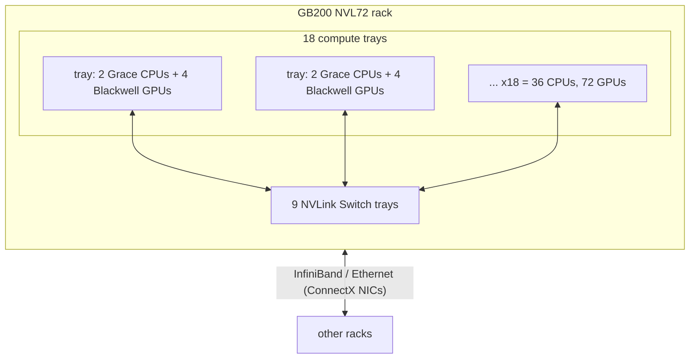

# DGX, HGX, MGX, NVL72: what each one is

These names describe different layers, and one machine can be several at once.

| Name | What it is | Examples | NVLink domain |
|---|---|---|---|
| **HGX** | NVIDIA's 8-GPU SXM baseboard with NVSwitch chips, sold to server makers | HGX H100, HGX B200, HGX B300 | 8 GPUs |
| **DGX** | NVIDIA's own complete systems, with DGX OS and NVIDIA's cluster software | DGX B200 / B300 (built on HGX), DGX GB200 / GB300 (NVL72 racks), DGX Spark (GB10 desktop) | depends on the system |
| **MGX** | NVIDIA's modular reference architecture that server makers build to; also the rack design NVL72 systems use | OEM GB200 NVL72 racks, Vera Rubin NVL72 (third-generation MGX rack) | n/a (it's a design spec) |
| **NVL72** | A liquid-cooled rack that joins 72 GPUs into one NVLink domain | GB200 NVL72, GB300 NVL72, Vera Rubin NVL72 | 72 GPUs |
| **DGX SuperPOD** | NVIDIA's reference design for clusters built from DGX systems or racks | many NVL72 racks plus InfiniBand/Ethernet scale-out | per rack |

**HPC** sits across all of them: the scheduler (Slurm), MPI, NCCL, InfiniBand, and
benchmarks like HPL.

## Inside a GB200 NVL72 rack

- Each GPU has 18 NVLink 5 links, 1.8 TB/s total. Through the switch trays every GPU can
  reach the other 71 at that speed, about 130 TB/s across the rack.
- Inside a tray, each Grace CPU connects to its two GPUs with **NVLink-C2C**. That's why
  host-to-device copies on GB200 run several times faster than over PCIe on an HGX node
  (`nvbandwidth` thresholds in `configs/thresholds.yaml` reflect this).
- One operating system sees only its own tray's 4 GPUs. Treating the 72 as one domain needs
  the **IMEX** service, which lets processes on different trays share GPU memory.
- **GB300 NVL72** keeps the layout with Blackwell Ultra GPUs (288 GB HBM3e each) and
  ConnectX-8 NICs. **Vera Rubin NVL72** replaces the CPUs with Vera and the GPUs with Rubin,
  with NVLink 6 at 3.6 TB/s per GPU, in the same third-generation MGX rack footprint.

## Terms used by the checks

| Term | Meaning | Where it shows up |
|---|---|---|
| **NV#** | `nvidia-smi topo -m` notation for a bonded set of # NVLinks between two GPUs | `topology.nvlink_symmetry`: every pair should show NV18 on HGX and NVL72 |
| **Fabric state** | Per-GPU field in `nvidia-smi -q`: whether the GPU has joined its NVLink fabric, with a clique ID and cluster UUID | `topology.nvlink_fabric`: must be `Completed` on Grace-based nodes |
| **IMEX / ComputeDomain** | IMEX daemons let GPUs on different trays map each other's memory. On Kubernetes the DRA driver sets this up per job as a *ComputeDomain* | `k8s/dra/` |
| **MNNVL** | Multi-node NVLink: NCCL running over that rack-wide domain instead of the network | `hpc/jobs/nccl-multinode.sbatch` |
| **NVLS** | NVLink SHARP: NVSwitches perform reductions themselves. All-reduce bus bandwidth can therefore exceed what the links alone would suggest | nccl all_reduce numbers |
| **algbw / busbw** | nccl-tests reports algorithm bandwidth (bytes / time) and bus bandwidth (algbw scaled by the collective's traffic pattern, comparable to link speed). Thresholds use busbw | `nccl.*.busbw` |
| **PIX / NODE / SYS** | PCIe distance from a GPU to a NIC: same switch, same CPU socket, other socket. GPUDirect RDMA wants PIX | `bcp topology` "Nearest NIC" |
| **XID** | Numbered GPU error reported by the driver | `k8s/monitoring/gpu-alerts.yaml` |
