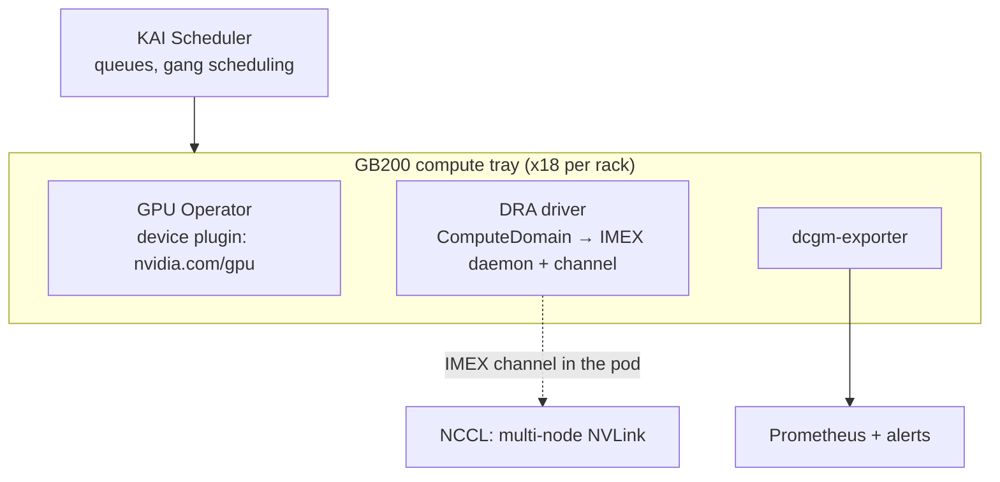

# Kubernetes

| Path | What it does | Status |
|---|---|---|
| `gpu-operator/values.yaml` | GPU Operator: container toolkit, CDI, DCGM exporter + ServiceMonitor | Draft |
| `dra/values.yaml` | DRA driver in ComputeDomain-only mode for NVL72 | Draft |
| `dra/nccl-computedomain.yaml` | nccl-tests across 2 NVL72 trays over multi-node NVLink | Draft, needs GB200/GB300 |
| `kai/queues.yaml` | KAI Scheduler queues: guaranteed inference GPUs, preemptible benchmarks | Draft |
| `monitoring/gpu-alerts.yaml` | Prometheus alerts: XID, HBM row remaps, temperature, NVLink stalls | Draft |

CI runs kubeconform on these manifests, using the community CRDs-catalog schemas where one
exists (PrometheusRule, MPIJob). ComputeDomain, KAI Queue and DynamoGraphDeployment have no
published schema there, so for those CI only checks that the YAML parses.

## How the pieces fit on an NVL72 rack

1. The **GPU Operator** exposes GPUs as `nvidia.com/gpu` and runs dcgm-exporter.
2. The **DRA driver** gives a group of pods a shared **ComputeDomain**: it starts an IMEX
   daemon on the selected trays and puts an IMEX channel in each pod. NCCL then sees GPUs
   on other trays as NVLink peers.
3. **KAI Scheduler** gang-schedules multi-pod jobs so all ranks start together, and shares
   the cluster between queues.
